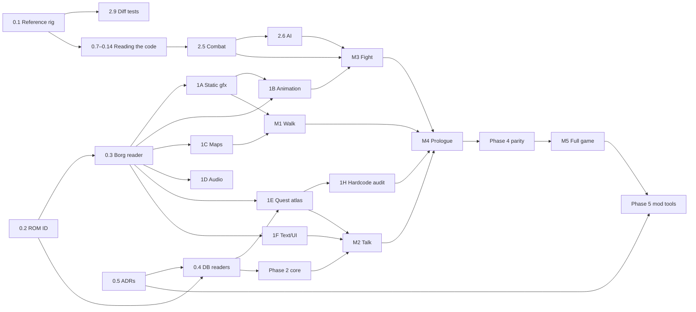

# Aidyn Chronicles Reimplementation: Roadmap

Sep 26, 2026 · Updated Oct 4, 2026

## Summary

This is the plan for building a PC engine reimplementation of Aidyn Chronicles: The First Mage. It runs on content from a user-supplied ROM and has a plugin-based mod system on top. The work is split into seven phases. Phase 0 blocks everything else and should be done first, carefully. Phase 1 splits into seven decoding tracks that can run in parallel. Everything after that is built on shared foundations and lands as a series of playable vertical slices.

The most important finding from the early research: **quest logic is almost entirely data, not code.** The game runs on three data systems:

- An event-flag logic network (`GameStateFunnel`).
- A dialogue and cut-scene bytecode (Borg13).
- Map objects gated by flags (Borg9).

Extracting quests is therefore mostly a file-format problem, not a code-lifting problem. The real code-lifting work is in **combat formulas, AI, and the roughly 270 places where engine code hardcodes specific flags**.

The game's architecture also resembles an ESM already. Its content is keyed records sitting in tables and one big asset archive. That makes the Bethesda-style mod system a natural fit rather than something bolted on.

## Where things stand

This is the one list of what's open. A task's status is in its phase's table below, and what was found and built is in the docs. When something finishes, take it off here, mark its task and suggest what's next. When a playtest or a finished task leaves work behind, add it here.

### Next

1. **0.8–0.9: reading the code without the decomp** ([ADR 0015](adr/0015-the-port-no-longer-reads-the-decomp.md)). These are the symbol map and the debug build's source files matched to 1.0, on top of the code index and Ghidra's pseudocode (0.7, 0.14). 0.10–0.12 can run alongside or after them.
2. **0.13: combat captures,** by the user, whenever it suits.
3. **M3 Fight:** 2.5 (combat rules) in the headless core, then 2.6 (enemy AI) and the battle UI, planned into sessions as M2 was. 2.5's first session maps combat's code and RAM with 0.7–0.13.

### Left over from finished work

- **M2:** backdrops and the help menu, the endings' cinematics, the System tab's Theater, Credits and Help, and the editor showing cut-scenes on its map, and the HUD.
- **Waiting for 2.5:**
  - Training after a battle.
  - The sundial's Detect Moon and Sun Phase spells.
  - Camping's ambush battle.
  - Boss flags, which battles set.
  - Spells' and potions' modifiers on characters.
  - The Antidote and Restore potions, which need combat's poison and spells.
- **Waiting for 1D:** sounds. Cues that play one are logged.
- **Waiting for the user:** shop selling prices ([to-check](to-check.md)).
- **1H:** the content tables marked To do in [hardcoded-content](hardcoded-content.md), which the importer will need.
- **Rendering:** the renderer's leftovers, the weather among them ([rendering](systems/rendering.md#whats-left)).
- **Rig:** measure the frame `delta` distribution in trek and combat ([ADR 0006](adr/0006-tick-model-and-rng.md)'s follow-up).

### UI fit and finish

These are the user's notes ([playtests](playtests.md)), for a later session.

- The Party tab's shield icon on the silhouette sits 2 pixels too high.
- The menu's animations (the list sliding in, the portraits moving, the details fading) draw the eye to where the controller has moved. Keep the top face button for details and the shoulders for the member.
- The Healer's popup needs a gap between its members' portraits, which overlap by 2 pixels (`roms/menu-party-skills-healer-layonhands.png`).
- Some map areas may not unlock by travelling into them, specifically the stone area north of the desert via the eastern beach. This may be how the original behaves.

### Maybe

- The editor showing wanderers on its map view.

## What the research changes

The early research drew these findings from the [blackgamma7/Aidyn](https://github.com/blackgamma7/Aidyn) decomp (headers in `include/`, cleaned pseudocode in `src_pseudo/`, around 71k lines), which the project read until [ADR 0015](adr/0015-the-port-no-longer-reads-the-decomp.md). AidynEditor ([TiberGuy/AidynEditor](https://github.com/TiberGuy/AidynEditor)) was the other source. Each track checked what it used against the ROM.

### The ROM is cleanly laid out

| Region (NA 1.0) | Contents |
| --- | --- |
| `0x0001000`–`0x00E7220` | Code segment. It also holds some data tables, such as the per-region map chunk lists and the dialogue SFX tables. |
| `0x00E7220`–`0x1F89C10` | **Borg archive**: about 30 MB holding every art, level, audio, and dialogue asset. |
| `0x1F89C10` | `Borg_List`: the archive index. Each entry has type, compression, compressed and uncompressed sizes, and offset. |
| `0x1FC2BB0`–`0x1FEEFD0` | Fixed databases: Entity, Weapon, Armor, Spell, Item, Chest, DialogEntity, GameStateMod, **GameStateFunnel**, Audiokey, Journal, Theatre menu, cinematic text, controller and combat strings, CampEncounters, cheats, credits, and the item, stat, and spell string tables. |

Compression comes in two schemes, LZB (most Borgs) and LZ01x (text). Strings also go through a decrypt step.

### The 15 Borg asset types

| # | Type | Notes |
| --- | --- | --- |
| 1 | Texture | N64 texel formats, with odd rows interleaved |
| 2 | Geometry | Vertices plus F3DEX display lists, mostly `G_TRI1` |
| 3 | Camera | FOV and clip planes |
| 4 | Light | |
| 5 | Model / scene graph | Transform tree, a small instruction list, and particle emitters |
| 6 | Animation | Keyframe tracks bound to a Borg5 |
| 7 | Actor | A Borg5 plus a set of Borg6 animations with branch and transition data |
| 8 | UI image | Viewable in Texture64 |
| 9 | Map chunk | Collision triangles, ground types, and **map objects** |
| 11 | DCM sample | 44.1 kHz mono PCM, 8-bit or 16-bit BE |
| 12 | Sequence | Music and SFX sequences over Borg11 instruments |
| 13 | Dialogue / cut-scene script | Bytecode with about 60 opcodes |
| 0, 10, 14 | Unused | Named GEN, CollisionMaterial, and GameState |

### Quest logic is data

- **`GameStateFunnel`** is a table of 5,627 event flags. There are 5,001 plain bits and 626 derived flags, each computed from other flags by one of these ops: AND, IOR, EOR, NOT, MSK, EQU, GRT, LST, NEQ, or a count. The runtime evaluates it as a logic network. Journal entries, calendar and moon phase, weather, terrain, and even party stats are all exposed as flags.
- **Borg13** scripts drive dialogue and scripted cut-scenes. They cover condition checks (flag, party member, skill, item, best or worst stat, gold, party size) and effects (set or unset flag, add gold, add item, add XP, add or remove member, shop, train, battle, camp heal). They also handle camera cues (cut, pan, sine, track) and actor cues (walk, run, face, create, show an item).
- **Borg9 map objects** place content in the world. The types are scene, container, light, audio, wander node, monster party, reference point, teleporter, camera, dialogue trigger, and trigger. Every map object carries `flagA/B/C` gates and an Expansion Pak or no-pak variant bit.

### Cinematics use the actor animation system

The four "Perfect Dark"-style scenes are a Borg5 scene driven by Borg6 animation, with fades and Borg12 audio. If Borg5, Borg6, and Borg7 are implemented correctly for actors, cinematics come mostly for free.

### A debug build exists

The final debug build, "02.01d-PRERELEASE", includes an event-flag viewer and editor, camera debug, a voxel index display, and debug party tools. For quest reverse engineering, it's the most valuable tool available. Its strings also name about 140 of the original's source files, such as `../combatengine/turn.cpp`, and some functions, such as `Entity::GetSpell()`. These are the original's own names, and the port uses them (0.9).

### What is still code-only

These systems are ported from the machine code rather than parsed from data:

- **Combat rules:** the debug build's `combatengine/combat.cpp`, `combatEntity.cpp` and `turn.cpp`, with `src/gamecombat.cpp`. The early research put them at about 5k lines.
- **AI:** `combatengine/aiInfo.cpp` and `aiscores.cpp`, about 2k lines.
- **Character and party logic,** ported in 2.2 and 2.3.
- **Player movement and physics,** ported for M1.
- **Wander behaviour,** ported for M2.
- **About 270 named flag references inside engine code,** listed by the 1H audit.

## Architecture decisions

Phase 0 settled how the reimplementation is built: the importer owns the ROM, Godot with C#, a headless rules core, the record IDs, the plugin format, the tick model and RNG, ROM versions and the content logic layers. They're the ADRs in [adr/](adr/README.md), which are binding.

## Phases

Sizes are relative: S, M, L, XL. **Bold** tasks block other work.

### Phase 0: Foundations (blocking)

| Task | Size | Output | Status |
| --- | --- | --- | --- |
| **0.1 Reference rig.** Set up an emulator with a debugger (ares or Mupen64Plus plus a GDB stub), obtain the NA 1.0 and debug ROMs, and build a save-state library at story checkpoints. | S | Ground truth to test against for the life of the project | Done |
| **0.2 ROM identification.** Hashing, byte-order normalisation, header parsing, and a per-version offset table. | S | `RomImage` class | Done |
| **0.3 Borg archive reader.** Parse `Borg_List` and port the LZB and LZ01x decompressors. Dump every Borg as raw decompressed blobs, grouped by type, with counts and sizes. | M | **Critical path.** Unblocks all of Phase 1. | Done |
| **0.4 DB table readers.** Entity, Weapon, Armor, Spell, Item, Chest, DialogEntity, shop, journal, CampEncounters, cinematic text, the GameStateFunnel raw table, and strings (with decrypt). Cross-check field meanings against AidynEditor. | M | Typed records | Done |
| **0.5 Architecture decisions,** written up as short ADRs. | S | `docs/adr/` | Done |
| **0.6 Asset inspector.** A Godot tool app for browsing Borgs by type and index, showing hex, decoded fields, and a preview. It becomes the editor over imported data ([ADR 0010](adr/0010-editor-reads-plugins.md)). | M, ongoing | The tool you'll use most | Done Sep 30, 2026. It keeps growing into the mod editor (Phase 5). |

#### Reading the code without the decomp

[ADR 0015](adr/0015-the-port-no-longer-reads-the-decomp.md) stops the project reading the decomp. These tasks give the rig what the decomp gave: a way to find a system's code, names for it, and the layout of what it touches. Each is a tool or a doc, and the [reference rig](reference-rig.md) says how to use it. Everything here reads the ROMs and checkpoints, and anything derived from them is written to the gitignored `out/`, except the symbol map, which holds only addresses and our names, as the docs already do.

| Task | Size | Output | Status |
| --- | --- | --- | --- |
| **0.7 Code index.** Read both ROMs' code segments. List every function, starting from `jal` targets and prologues. Record each function's callers and callees, the data and strings it references (`lui` pairs), and the jump tables. Then `n64dis.py` gains `--callers`, `--callees`, `--refs <address>` and `--strings <text>`. | M | Finding code by what it touches: the string it prints, the table it reads, the global it writes | Done Oct 4, 2026, as an export from Ghidra (0.14); see the [rig](reference-rig.md#ghidra-1214-roadmap-07-014) |
| **0.8 Symbol map.** `tools/symbols/us.txt` and `debug.txt`, our names for addresses, which `n64dis.py` reads. Seed it from the ~150 addresses the docs and code already cite. Add the C runtime and libultra functions, recognised by what they do (`memcpy`, `sprintf`, `sinf`, `osRecvMesg`). Every research run adds the names it settles. | S, then ongoing | Calls named in every disassembly | Next, with 0.7 |
| **0.9 Source files and the two builds.** The debug build's allocations and asserts pass a file name and line, so each function that calls one can be tied to its file, and its line numbers order the file's functions. Then match 1.0's functions to the debug build's, by order and by instruction shape, so that a name settled in either build holds in both. | M | Every function placed in one of the original's ~140 source files. The debug build's names carry to 1.0. | After 0.7 |
| **0.10 RAM maps.** `bst.py --diff` between two checkpoints, and a way to name a RAM structure's fields once they're settled. The structures go in the system's doc, as [saves](systems/saves.md) does for the save. | S | Where a value lives, found by changing it in the game | Open |
| **0.11 gdb on a checkpoint.** Fix gdb after loading a save state (the [known issue](reference-rig.md#known-issue-gdb-after-loading-a-state)). If ares's stub can't, try another emulator with a GDB stub. Breakpoints and watchpoints then work from any checkpoint. | S–M | "What writes this value?" answered by a watchpoint, in one run | Open |
| **0.12 Traces.** Log which functions run during an action, by breakpoints on function entries or by an emulator's tracer. Diff an action against standing still. | M | The code an action runs, such as one attack, found without guessing | After 0.7 and 0.11 |
| **0.13 Combat captures** (the user). Checkpoints in and around battles: on the field just before one, its first turn, before and after a melee attack, before and after a spell, an enemy's turn, fleeing, and victory with its loot and experience screens. The existing saves are from a ROM hack with weak enemies, so these should come from an unmodified 1.0 game. | S | Combat's RAM, before and after each thing it does | Open |
| **0.14 A decompiler of our own** (optional). Try Ghidra headless over 1.0, written to `out/` and never committed, with the symbol map applied. See whether its output makes research runs cheaper than raw disassembly. It needs Java and Ghidra installed. | S to try | Readable pseudocode that is ours, if it pays | Done Oct 4, 2026. It pays: every function decompiles, readably, and the analysis gives 0.7's index. |

### Phase 1: Format decoding (parallel tracks, after 0.3)

Each track ends with an exporter to an open format and a viewer in the inspector. These are the validation gates: if it round-trips visually, it's understood.

| Track | Tasks | Size | Validation | Status |
| --- | --- | --- | --- | --- |
| **1A Static graphics** | Borg1 textures (every N64 format, de-interleave, TLUT), Borg8 UI images, Borg2 via a minimal F3DEX interpreter, Borg3 camera, Borg4 lights, Borg5 scene graph (transforms, instruction list, texture binds) | L | glTF export of a building and a character matches the emulator | Done |
| **1B Animation** | Borg6 tracks and keyframes, Borg7 actor animation sets, branches, and transitions, Borg5 particles | L | The opening cinematic plays in the inspector | Done Sep 27, 2026: the user confirmed all 13 shots |
| **1C Maps** | Chunk tables per map region (from the code segment), Borg9 collision (triangles, collide sections, ground types), all map object types, Expansion Pak variants | L | A map viewer shows a whole region, with objects overlaid by type | Done Sep 27, 2026 |
| **1D Audio** | Borg11 PCM, Borg12 sequence format and playback, the audiokey table | M | BGM plays correctly | Open |
| **1E Quest atlas** | Borg13 decoding, including **branching semantics** (`text_marker`, `a/b`, `index`, `bitmask`, choices), the GameStateFunnel logic network, flag cross-referencing, and journal linkage | L | See below | Done |
| **1F Text & UI assets** | All string tables, the font, portraits, menu images | S | Full text dump; the dialogue box renders in the right font | Done |
| **1G Saves** (optional) | Importing the original's Controller Pak saves: the bit-packed party, the 640-byte flag block, the 1,984-byte game state, the 4 KB 64×32 screenshot, the minimap, the `voxelChart`, and the checksum | M | An original Controller Pak save imports | Open. The checkpoints already convert into saves (2.8). |

**Track 1E is how quest extraction becomes tractable.** Build a cross-reference database that answers, for every flag:

- What sets it: Borg13 `SetFlag`, trigger map objects, code, or time and weather setters.
- What reads it: map objects' `flagA/B/C` gates, Borg13 checks, logic-network inputs, or code.
- Which journal entry it maps to.

Render the database as a graph. At that point, "how does the Rheda / Niesen quest work?" becomes a graph query rather than an investigation. The debug ROM's flag viewer lets each finding be confirmed live.

**Track 1H: hardcoded-content audit** (M, runs alongside 1E; done, with tables left To do). List every piece of content that lives in code rather than data:

- The roughly 270 `FLAG_*` references.
- The asset indices the code names.
- The campfire scenes, boss flags, and the cinematic tables.
- Cheat codes.
- Party join and leave rules, such as Brenna never leaving and Rheda's condition, if they're in code.
- Special-case trainers (AidynEditor notes Becan).

Each of these is assigned to one of the four layers in [ADR 0008](adr/0008-content-logic-layers.md): a record, a trigger, a parameterised engine feature, or, rarely, a script. Whichever layer it lands in, mods can change it. A first pass found most of the flag references are tables written as code, and only about half a dozen are truly bespoke behaviours, led by the Goblin Ambush. This is the actual code-side quest-logic work, and it's bounded. The audit is kept in [hardcoded-content.md](hardcoded-content.md).

### Phase 2: Rules core (headless, test-driven)

Work can start once 0.4 and 0.5 are done; each part slots in as its Phase 1 track completes. Where a task names the original's code, the file names are the debug build's own.

| Task | Size | Source | Status |
| --- | --- | --- | --- |
| **2.1 Flag engine.** An exact port of `ProcessGameStates`, plus the time, calendar, weather, terrain, and stat flag setters. | M | `gamestatefunnel.cpp` | Done |
| **2.2 Characters.** Attributes, skills, weapon skills, level thresholds, HP formula, XP costs, trainer costs, learnable-skill masks, stat modifiers, resistances. | M | `gameclasses/` | Done Sep 30, 2026 |
| **2.3 Items & inventory.** Categories, equip rules, shops (buy and sell filters, Merchant pricing), chests (loot categories, Ranger bonus, locks and traps), crafting (Alchemist, Healer, Mechanic). | M | `data/itemdb.cpp`, `chestdb.cpp`, `shopdb.cpp`, crafting | Done Oct 1, 2026 |
| **2.4 Borg13 VM.** Executes scripts against core state. Camera and actor cues go out through a host interface, so the core stays headless. | M | `dialogue.cpp` | Done |
| **2.5 Combat rules.** Turn order, field-of-influence radius, hit, damage, and crit, spells (targeting modes, radius formula, reagents, battery), status effects, reserve spawns, leader and flee logic, rewards. | **XL** | `combatengine/combat.cpp`, `combatEntity.cpp`, `turn.cpp`, `src/gamecombat.cpp`, the DB's combat strings | Next, after 0.7–0.9 and 0.13 |
| **2.6 Enemy AI.** | L | `combatengine/aiInfo.cpp`, `aiscores.cpp` | After 2.5 |
| **2.7 Time & camping.** The day clock, the 8-hour camp, battery regeneration, the ambush roll, camp encounters. See [camping](systems/camping.md). | S | `sundial.cpp`, `menus/campmenucontroller.cpp` | Done Oct 4, 2026; the ambush's battle waits for 2.5 |
| **2.8 Save/load** in the engine's own format. See [saves](systems/saves.md). | S | `questdata.cpp`, `saveParty.cpp` | Done Oct 1, 2026 |
| **2.9 Differential tests.** Capture the random values the emulator consumed (see ADR 0006), replay them into the core, and compare damage and turn logs. | L, ongoing | | Open; needs 0.11 |
| **2.10 Events and triggers.** The core's named event list, and the trigger records (*on event, if condition, do effects*) using Borg13's condition and effect vocabulary. Engine features that replace bespoke code (ADR 0008 layer 3) land with the system they belong to. | M | The 1H audit, and the code each event comes from | Open |

### Phase 3: Godot runtime

Work moves through a series of vertical slices, each one playable.

| Slice | Contents | Needs | Status |
| --- | --- | --- | --- |
| **M1: Walk Gwernia** | The 3×3 chunk streamer, terrain rendering, an N64-look shader (vertex colour, fog, three-point filtering option), collision, the player controller, the SM64-style camera, sky, sun and moon, clouds, lens flare, per-object draw distance | 1A, 1C | Done Sep 29, 2026 |
| **M2: Talk and trade** | Map objects at run time (containers, teleporters with fade, triggers, dialogue triggers), actors with wander nodes, dialogue UI with portraits and choices, shops, the pause menu (Party, System, World tabs), journal, cut-scenes, training, camping, the trek HUD | 1E, 1F, 2.1–2.4 | Done Oct 4, 2026; leftovers [above](#left-over-from-finished-work) |
| **M3: Fight** | Arena loading, spawns, the turn UI, radius targeting, spell visuals and particles, the combat log, status icons, post-battle XP and loot screens | 1B, 2.5, 2.6 | Next |
| **M4: The prologue** | From the opening through leaving Gwernia, end to end: cinematics, scripted cut-scenes, party joins, camping, audio | Everything above | |
| **M5: Full playthrough parity** | Every region, every quest, and the ending, checked against the quest atlas | Phase 4 | |

### Phase 4: Content parity

This phase is sized XL, but most of the time goes into testing rather than engineering.

- Walk every region against the emulator and log differences.
- Use the quest atlas as a checklist. Every flag should be reachable, and every journal entry should be obtainable.
- Rules parity: shops, trainers, loot tables, and camp encounters for each area.
- Decide which original bugs to keep. Offer a fidelity toggle for bugs such as the `CheckPartyGoldU16` truncation, the crash when `TakeItem` runs on an item the party doesn't have, and the status-icon cycle gap.

### Phase 5: Mod system and tools

| Task | Size |
| --- | --- |
| Plugin loader: load order, dependencies, field-level merge, conflict report | M |
| Flag and ID allocation for mod namespaces | S |
| Asset overrides (glTF, PNG, OGG) and new assets | M |
| Scripting: a Borg13 superset for dialogue and cut-scenes (new opcodes as needed), plus sandboxed Lua event handlers on the 2.10 events, per ADR 0008. Mods can't load .NET assemblies. | L |
| **Editor.** Grow the Phase 0.6 inspector into a Construction Set: record editing, dialogue graph editing, map object placement in the map viewer, and a quest atlas that includes mod content | XL |
| Documentation and a sample mod (for example, a new trainer, a new quest, and a rebalanced spell) | M |

The mod format is designed in Phase 0 and exercised all the time, because the base game is a plugin. Phase 5 is only about exposing it and building tooling on top.

### Phase 6: Enhancements (optional, post-parity)

Widescreen, higher resolution, higher frame rate (which depends on the tick model), longer draw distance, rebindable controls, quality-of-life options such as visible stealth feedback, and bug-fix toggles. Keep every enhancement behind a fidelity profile.

Some came early and are the default. The UI floats a feathered conversation box and draws on a screen of any shape and size, and the faithful mode they replace, with its overscan bars, is left for here: see [ui](systems/ui.md#a-faithful-mode-later).

## Dependency graph

## Risk register

| Risk | Impact | Mitigation |
| --- | --- | --- |
| Borg6 animation format has many unknown fields | Actors and cinematics stall | **Retired (Sep 27, 2026).** Borg6 turned out to be forward-differenced polynomial tracks on Borg5 transforms. Every animation plays bit for bit as the game steps it. See [formats/animation.md](formats/animation.md). |
| Combat and AI formulas are hard to verify by eye | Balance feels "off" | Exact RNG port plus scripted differential tests (2.9). Read constants from the machine code rather than inferring them from play. |
| Finding code without the decomp's map ([ADR 0015](adr/0015-the-port-no-longer-reads-the-decomp.md)) | Research runs cost more, and a system's code can be missed | The code index, the symbol map and the debug build's source files (0.7–0.9), with watchpoints and traces on checkpoints (0.11, 0.12). Every run adds the names it settles. |
| F3DEX render modes and combiner modes | Visual mismatches | Implement only what the game uses, mostly `G_TRI1`. Map combiner states to a few shader variants. |
| Logic tied to frame rate | Breaks higher frame rates | Resolve the tick model in 0.5 and run the core on a fixed tick. |
| Content hardcoded in code that the audit misses | Mods can't reach it, or content is missing | The 1H audit and the quest-atlas reachability check in Phase 4 |
| Scope fatigue over several years | Project dies | Vertical slices (M1–M4) so something is always playable. The inspector is useful to the community on its own, early. |
| Legal | Takedown | Never distribute ROM-derived assets or data; plugins ship only as deltas and original assets. The project no longer reads the decomp, which has **no licence** ([ADR 0015](adr/0015-the-port-no-longer-reads-the-decomp.md)), and never copied its code. The README credits it for the early research. |
