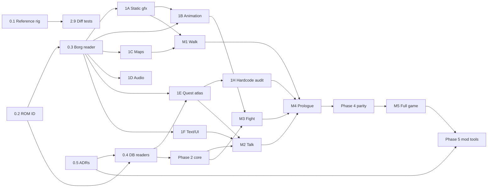

# Aidyn Chronicles Reimplementation: Roadmap

Sep 26, 2026

## Summary

This is the plan for building a PC engine reimplementation of Aidyn Chronicles: The First Mage. It runs on content from a user-supplied ROM and has a plugin-based mod system on top. The work is split into seven phases. Phase 0 blocks everything else and should be done first, carefully. Phase 1 splits into seven decoding tracks that can run in parallel. Everything after that is built on shared foundations and lands as a series of playable vertical slices.

The most important finding from the research: **quest logic is almost entirely data, not code.** The blackgamma7 decomp shows that the game runs on three data systems:

- An event-flag logic network (`GameStateFunnel`).
- A dialogue and cut-scene bytecode (Borg13).
- Map objects gated by flags (Borg9).

Extracting quests is therefore mostly a file-format problem, not a code-lifting problem. The real code-lifting work is in **combat formulas, AI, and the roughly 270 places where engine code hardcodes specific flags**.

The game's architecture also resembles an ESM already. Its content is keyed records sitting in tables and one big asset archive. That makes the Bethesda-style mod system a natural fit rather than something bolted on.

## What the research changes

These findings come from the [blackgamma7/Aidyn](https://github.com/blackgamma7/Aidyn) decomp (headers in `include/`, cleaned pseudocode in `src_pseudo/`, around 71k lines) and from [TiberGuy/AidynEditor](https://github.com/TiberGuy/AidynEditor).

### The ROM is cleanly laid out

| Region (NA 1.0) | Contents |
| --- | --- |
| `0x0001000`–`0x00E7220` | Code segment. It also holds some data tables, such as the per-region map chunk lists in `BorgMapLists.cpp` and the dialogue SFX tables. |
| `0x00E7220`–`0x1F89C10` | **Borg archive**: about 30 MB holding every art, level, audio, and dialogue asset. |
| `0x1F89C10` | `Borg_List`: the archive index. Each entry has type, compression, compressed and uncompressed sizes, and offset. |
| `0x1FC2BB0`–`0x1FEEFD0` | Fixed databases: Entity, Weapon, Armor, Spell, Item, Chest, DialogEntity, GameStateMod, **GameStateFunnel**, Audiokey, Journal, Theatre menu, cinematic text, controller and combat strings, CampEncounters, cheats, credits, and the item, stat, and spell string tables. |

Compression comes in two schemes, LZB (most Borgs) and LZ01x (text). Both decompressors are in the decomp. Strings also go through a decrypt step (`other/decryptString.cpp`).

### The 15 Borg asset types

| # | Type | Notes |
| --- | --- | --- |
| 1 | Texture | N64 texel formats, with odd rows interleaved |
| 2 | Geometry | Vertices plus F3DEX display lists, mostly `G_TRI1` |
| 3 | Camera | FOV and clip planes |
| 4 | Light | |
| 5 | Model / scene graph | Transform tree, a small instruction list, and particle emitters |
| 6 | Animation | Keyframe tracks bound to a Borg5. Many fields are still unknown. |
| 7 | Actor | A Borg5 plus a set of Borg6 animations with branch and transition data |
| 8 | UI image | Viewable in Texture64 |
| 9 | Map chunk | Collision triangles, ground types, and **map objects** |
| 11 | DCM sample | 44.1 kHz mono PCM, 8-bit or 16-bit BE |
| 12 | Sequence | Music and SFX sequences over Borg11 instruments |
| 13 | Dialogue / cut-scene script | Bytecode with about 60 opcodes, already enumerated |
| 0, 10, 14 | Unused | Named GEN, CollisionMaterial, and GameState |

### Quest logic is data

- **`GameStateFunnel`** is a table of 5,627 event flags. There are 5,001 plain bits and 626 derived flags, each computed from other flags by one of these ops: AND, IOR, EOR, NOT, MSK, EQU, GRT, LST, NEQ, or a count. The runtime evaluates it as a logic network (`ProcessGameStates`). Journal entries, calendar and moon phase, weather, terrain, and even party stats (`eventflagArrayStats`) are all exposed as flags.
- **Borg13** scripts drive dialogue and scripted cut-scenes. They cover condition checks (flag, party member, skill, item, best or worst stat, gold, party size) and effects (set or unset flag, add gold, add item, add XP, add or remove member, shop, train, battle, camp heal). They also handle camera cues (cut, pan, sine, track) and actor cues (walk, run, face, create, show an item).
- **Borg9 map objects** place content in the world. The types are scene, container, light, audio, wander node, monster party, reference point, teleporter, camera, dialogue trigger, and trigger. Every map object carries `flagA/B/C` gates and an Expansion Pak or no-pak variant bit.

### Cinematics use the actor animation system

The four "Perfect Dark"-style scenes are `CinematicStruct`s: a Borg5 scene driven by Borg6 animation, with fades and Borg12 audio. If Borg5, Borg6, and Borg7 are implemented correctly for actors, cinematics come mostly for free. **Borg6 is the single biggest technical unknown in the project.**

### A debug build exists

The final debug build, "02.01d-PRERELEASE", is what the decomp is primarily based on. It includes an event-flag viewer and editor, camera debug, a voxel index display, and debug party tools. For quest reverse engineering, it's the most valuable tool available.

### What is still code-only

The following systems have to be ported by reading pseudocode rather than parsed from data:

- Combat rules: `combatEntity.cpp`, `combatEngine.cpp`, and `gameCombat.cpp`, about 5k lines.
- AI: `ai.cpp` and `aiScore.cpp`, about 2k lines with many unknown fields.
- Character and party logic: `entity.cpp` and `party.cpp`, about 4k lines.
- Player movement and physics.
- Wander behaviour.
- About 270 named flag references inside engine code.

## Architecture decisions

Phase 0 settled how the reimplementation is built: the importer owns the ROM, Godot with C#, a headless rules core, the record IDs, the plugin format, the tick model and RNG, ROM versions and the content logic layers. They're the ADRs in [adr/](adr/README.md), which are binding.

## Phases

Sizes are relative: S, M, L, XL. **Bold** tasks block other work.

### Phase 0: Foundations (blocking)

| Task | Size | Output |
| --- | --- | --- |
| **0.1 Reference rig.** Set up an emulator with a debugger (ares or Mupen64Plus plus a GDB stub), obtain the NA 1.0 and debug ROMs, and build a save-state library at story checkpoints. | S | Ground truth to test against for the life of the project |
| **0.2 ROM identification.** Hashing, byte-order normalisation, header parsing, and a per-version offset table. | S | `RomImage` class |
| **0.3 Borg archive reader.** Parse `Borg_List` and port the LZB and LZ01x decompressors. Dump every Borg as raw decompressed blobs, grouped by type, with counts and sizes. | M | **Critical path.** Unblocks all of Phase 1. |
| **0.4 DB table readers.** Entity, Weapon, Armor, Spell, Item, Chest, DialogEntity, shop, journal, CampEncounters, cinematic text, the GameStateFunnel raw table, and strings (with decrypt). Cross-check field meanings against AidynEditor. | M | Typed records |
| **0.5 Architecture decisions,** written up as short ADRs. | S | `docs/adr/` (done) |
| **0.6 Asset inspector.** A Godot tool app for browsing Borgs by type and index, showing hex, decoded fields, and a preview. It grows with every Phase 1 track and later becomes the mod editor. | M, ongoing | The tool you'll use most. **Started Sep 27, 2026:** Godot 4.7.2 (.NET) is pinned, and `src/Aidyn.Inspector` browses every Borg with its preview, fields and hex. **Sep 29, 2026:** per [ADR 0010](adr/0010-editor-reads-plugins.md) it becomes the editor over imported data only. **Done Sep 30, 2026:** the editor shows everything the HTML viewers and the Borg browser did, over imported data, and they're deleted. It keeps growing into the mod editor (Phase 5). |

### Phase 1: Format decoding (parallel tracks, after 0.3)

Each track ends with an exporter to an open format and a viewer in the inspector. These are the validation gates: if it round-trips visually, it's understood.

| Track | Tasks | Size | Validation |
| --- | --- | --- | --- |
| **1A Static graphics** | Borg1 textures (every N64 format, de-interleave, TLUT), Borg8 UI images, Borg2 via a minimal F3DEX interpreter, Borg3 camera, Borg4 lights, Borg5 scene graph (transforms, instruction list, texture binds) | L | glTF export of a building and a character matches the emulator |
| **1B Animation** | Borg6 tracks and keyframes (map every unknown field), Borg7 actor animation sets, branches, and transitions, Borg5 particles | L (first sized XL, as the highest risk; see the risk register) | The opening cinematic plays in the inspector (the scene viewer stands in until 0.6). **Done Sep 27, 2026:** the user confirmed all 13 shots. |
| **1C Maps** | Chunk tables per map region (from the code segment), Borg9 collision (triangles, collide sections, ground types), all map object types, Expansion Pak variants | L | A map viewer shows a whole region, with objects overlaid by type. **Done Sep 27, 2026:** the user confirmed the layout, terrain, objects and enemy spawns in `tools/map-viewer.html`. |
| **1D Audio** | Borg11 PCM, Borg12 sequence format and playback, the audiokey table | M | BGM plays correctly |
| **1E Quest atlas** | Borg13 decoding, including **branching semantics** (`text_marker`, `a/b`, `index`, `bitmask`, choices; see `DialogNode.cpp`), the GameStateFunnel logic network, flag cross-referencing, and journal linkage | L | See below |
| **1F Text & UI assets** | All string tables, the font (`fontFace`), portraits, menu images | S | Full text dump; the dialogue box renders in the right font |
| **1G Saves** (optional) | The `SaveDatStruct` layout: bit-packed party, the 640-byte flag block, the 1,984-byte game state, the 4 KB 64×32 screenshot, the minimap, the `voxelChart`, and the checksum | M | An original Controller Pak save imports |

**Track 1E is how quest extraction becomes tractable.** Build a cross-reference database that answers, for every flag:

- What sets it: Borg13 `SetFlag`, trigger map objects, code, or time and weather setters.
- What reads it: map objects' `flagA/B/C` gates, Borg13 checks, logic-network inputs, or code.
- Which journal entry it maps to.

Render the database as a graph. At that point, "how does the Rheda / Niesen quest work?" becomes a graph query rather than an investigation. The debug ROM's flag viewer lets each finding be confirmed live.

**Track 1H: hardcoded-content audit** (M, runs alongside 1E). List every piece of content that lives in code rather than data:

- The roughly 270 `FLAG_*` references.
- The asset indices in `Borgindecies.h`.
- `isCampfireScene`, `bossflag`, and the cinematic tables.
- Cheat codes.
- Party join and leave rules, such as Brenna never leaving and Rheda's condition, if they're in code.
- Special-case trainers (AidynEditor notes Becan).

Each of these is assigned to one of the four layers in [ADR 0008](adr/0008-content-logic-layers.md): a record, a trigger, a parameterised engine feature, or, rarely, a script. Whichever layer it lands in, mods can change it. A first pass found most of the flag references are tables written as code, and only about half a dozen are truly bespoke behaviours, led by the Goblin Ambush. This is the actual code-side quest-logic work, and it's bounded. The audit is kept in [hardcoded-content.md](hardcoded-content.md).

### Phase 2: Rules core (headless, test-driven)

Work can start once 0.4 and 0.5 are done; each part slots in as its Phase 1 track completes.

| Task | Size | Source |
| --- | --- | --- |
| **2.1 Flag engine.** An exact port of `ProcessGameStates`, plus the time, calendar, weather, terrain, and stat flag setters. | M | `gamestatelib.cpp`, `gameStateFunnel.cpp` |
| **2.2 Characters.** Attributes, skills, weapon skills, level thresholds, HP formula, XP costs, trainer costs, learnable-skill masks, stat modifiers, resistances. **Done Sep 30, 2026:** gear's modifiers wait for 2.3, and spells' and potions' for 2.5. | M | `gameclasses/` |
| **2.3 Items & inventory.** Categories, equip rules, shops (buy and sell filters, Merchant pricing), chests (loot categories, Ranger bonus, locks and traps), crafting (Alchemist, Healer, Mechanic). **Done Oct 1, 2026:** the core, and the editor's item, shop, loot and recipe pages, equipment on character sheets, and items in the script player and the quest atlas. Boss flags, which battles set, moved to 2.5. | M | `itemdb`, `chestdb`, `shopdb`, crafting |
| **2.4 Borg13 VM.** Executes scripts against core state. Camera and actor cues go out through a host interface, so the core stays headless. | M | `dialogue.cpp`, `DialogNode.cpp` |
| **2.5 Combat rules.** Turn order, field-of-influence radius, hit, damage, and crit, spells (targeting modes, radius formula, reagents, battery), status effects, reserve spawns, leader and flee logic, rewards. | **XL** | `combat/` |
| **2.6 Enemy AI.** Port `aiScore` and `ai.cpp`. | L | `combat/ai*.cpp` |
| **2.7 Time & camping.** The day clock, the 8-hour camp, battery regeneration, the ambush roll, camp encounters. | S | `Camp.cpp`, `sundail.cpp` |
| **2.8 Save/load** in the engine's own format. **Done Oct 1, 2026:** the core's `GameState`, a JSON format holding what the original's save holds, loading as the original does, and the checkpoints converted into saves; see [saves](systems/saves.md). The System tab's saving and loading come with M2. | S | `QuestData.cpp`, `saveParty.cpp` |
| **2.9 Differential tests.** Capture the random values the emulator consumed (see ADR 0006), replay them into the core, and compare damage and turn logs. | L, ongoing | |
| **2.10 Events and triggers.** The core's named event list, and the trigger records (*on event, if condition, do effects*) using Borg13's condition and effect vocabulary. Engine features that replace bespoke code (ADR 0008 layer 3) land with the system they belong to. | M | 1H audit, `bossflag.cpp`, `WidgetBarterControl.cpp`, etc. |

### Phase 3: Godot runtime

Work moves through a series of vertical slices, each one playable.

| Slice | Contents | Needs |
| --- | --- | --- |
| **M1: Walk Gwernia** | The 3×3 chunk streamer, terrain rendering, an N64-look shader (vertex colour, fog, three-point filtering option), collision, the player controller, the SM64-style camera, sky, sun and moon, clouds, lens flare, draw-distance tiers. **Started Sep 27, 2026:** the importer's first slice writes the base plugin M1 loads. **Done Sep 29, 2026:** draw distance turned out to be per object, with fades, not tiers. Comparing day and night lighting with the console moved to the weather pass. | 1A, 1C |
| **M2: Talk and trade** | Map objects at run time (containers, teleporters with fade, triggers, dialogue triggers), actors with wander nodes, dialogue UI with portraits and choices, shops, the pause menu (Party, System, World tabs), journal | 1E, 1F, 2.1–2.4 |
| **M3: Fight** | Arena loading, spawns, the turn UI, radius targeting, spell visuals and particles, the combat log, status icons, post-battle XP and loot screens | 1B, 2.5, 2.6 |
| **M4: The prologue** | From the opening through leaving Gwernia, end to end: cinematics, scripted cut-scenes, party joins, camping, audio | Everything above |
| **M5: Full playthrough parity** | Every region, every quest, and the ending, checked against the quest atlas | Phase 4 |

### Phase 4: Content parity

This phase is sized XL, but most of the time goes into testing rather than engineering.

- Walk every region against the emulator and log differences.
- Use the quest atlas as a checklist. Every flag should be reachable, and every journal entry should be obtainable.
- Rules parity: shops, trainers, loot tables, and camp encounters for each area.
- Decide which original bugs to keep. Offer a fidelity toggle for bugs such as the `CheckPartyGoldU16` truncation, the crash when `TakeItem` runs on an item the party doesn't have, and the status-icon cycle gap.

### Phase 5: Mod system and tools

| Task | Size |
| --- | --- |
| Plugin loader: load order, dependencies, field-level merge, conflict report | M |
| Flag and ID allocation for mod namespaces | S |
| Asset overrides (glTF, PNG, OGG) and new assets | M |
| Scripting: a Borg13 superset for dialogue and cut-scenes (new opcodes as needed), plus sandboxed Lua event handlers on the 2.10 events, per ADR 0008. Mods can't load .NET assemblies. | L |
| **Editor.** Grow the Phase 0.6 inspector into a Construction Set: record editing, dialogue graph editing, map object placement in the map viewer, and a quest atlas that includes mod content | XL |
| Documentation and a sample mod (for example, a new trainer, a new quest, and a rebalanced spell) | M |

The mod format is designed in Phase 0 and exercised all the time, because the base game is a plugin. Phase 5 is only about exposing it and building tooling on top.

### Phase 6: Enhancements (optional, post-parity)

Widescreen, higher resolution, higher frame rate (which depends on the tick model), longer draw distance, rebindable controls, quality-of-life options such as visible stealth feedback, and bug-fix toggles. Keep every enhancement behind a fidelity profile.

Some came early and are the default. The UI floats a feathered conversation box and draws on a screen of any shape and size, and the faithful mode they replace, with its overscan bars, is left for here: see [ui](systems/ui.md#a-faithful-mode-later).

## Dependency graph

## Risk register

| Risk | Impact | Mitigation |
| --- | --- | --- |
| Borg6 animation format has many unknown fields | Actors and cinematics stall | **Retired (Sep 27, 2026).** Borg6 turned out to be forward-differenced polynomial tracks on Borg5 transforms, and the data uses none of the variants the code allows but the decomp couldn't explain. Every animation plays bit for bit as the game steps it. See [formats/animation.md](formats/animation.md). |
| Combat and AI formulas are hard to verify by eye | Balance feels "off" | Exact RNG port plus scripted differential tests (2.9). Read constants straight from the pseudocode rather than inferring them from play. |
| F3DEX render modes and combiner modes | Visual mismatches | Implement only what the game uses; the decomp says mostly `G_TRI1`. Map combiner states to a few shader variants. |
| Logic tied to frame rate | Breaks higher frame rates | Resolve the tick model in 0.5 and run the core on a fixed tick. |
| Decomp field names are guesses, and Ghidra quirks remain | Subtle bugs | Treat the pseudocode as a strong hint and the emulator as ground truth. |
| Content hardcoded in code that the audit misses | Mods can't reach it, or content is missing | The 1H audit and the quest-atlas reachability check in Phase 4 |
| Scope fatigue over several years | Project dies | Vertical slices (M1–M4) so something is always playable. The inspector is useful to the community on its own, early. |
| Legal | Takedown | Never distribute ROM-derived assets or data; plugins ship only as deltas and original assets. The decomp repo has **no license file**, so read it for understanding, but don't copy code wholesale into a project with its own license. Contact blackgamma7 early. Their README says no LLMs were used in their work, so it's worth being upfront about how this project is built when you approach them. |
