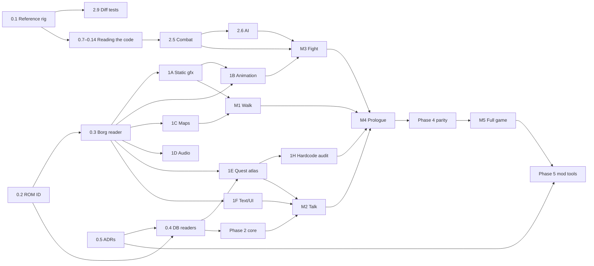

# Aidyn Chronicles Reimplementation: Roadmap

Sep 26, 2026 · Updated Oct 19, 2026

## Summary

A PC reimplementation of Aidyn Chronicles: The First Mage that runs on content imported from a user-supplied ROM, with a plugin-based mod system on top. Phase 0 laid the foundations, Phase 1 decoded the formats in parallel tracks, and everything since lands as playable vertical slices on a headless rules core.

**Quest logic is almost entirely data, not code.** The game runs on three data systems: an event-flag logic network (`GameStateFunnel`, [flags](systems/flags.md)), a dialogue and cut-scene bytecode (Borg13, [scripts](systems/scripts.md)), and map objects gated by flags (Borg9, [map-objects](systems/map-objects.md)). So extracting quests is a file-format problem. The code-lifting work is in **combat formulas, AI, and the places where engine code hardcodes content** ([hardcoded-content](hardcoded-content.md)). The game's content is already keyed records in tables and one big asset archive ([rom](formats/rom.md)), which makes a Bethesda-style mod system a natural fit.

These systems are ported from the machine code rather than parsed from data: combat (the debug build's `combatengine/combat.cpp`, `combatEntity.cpp`, `turn.cpp` and `src/gamecombat.cpp`, about 5k lines), its AI (`combatengine/aiInfo.cpp` and `aiscores.cpp`, about 2k), character and party logic (2.2, 2.3), movement and physics (M1), wanderers (M2), and the hardcoded content (1H). The debug build "02.01d-PRERELEASE" names 117 of the original's source files and some functions, which the port uses (0.9).

## Where things stand

This is the one list of what's open. A task's status is in its phase's table below, and what was found and built is in the docs. When something finishes, take it off here, mark its task and suggest what's next. When a playtest or a finished task leaves work behind, add it here. What only the user can check is in [user-checks](user-checks.md).

### Next

Next, by the phases' order, is **M4: the prologue**, from the opening through leaving Gwernia, end to end. It needs first:

1. **2.10's events and triggers**, with what starts the cinematics and what follows them: a new game's opening cinematic and script 866 after it, the scripts' ends that play Roog's and the ending's, Alaron's True Name and the credits ([cinematics](systems/cinematics.md#what-starts-them)). The Shadow's is M3's and already plays.
2. **A playthrough of the prologue** against the emulator, the user playing the original alongside: the opening, Gwernia, the Goblin Ambush and Oriana's hut, and the way out, logging what differs, as M3's battles were.
3. Whatever that turns up in the leftovers below that the prologue reaches.

### Left over from finished work

- **M2:** what starts the cinematics in the story (a new game's opening, the Shadow's, the ends of the Rooughah and last scenes) and what follows them (script 866, Alaron's True Name, the ending's credits), as 2.10's triggers ([cinematics](systems/cinematics.md#what-starts-them)); the editor showing cut-scenes on its map; and the HUD in the editor.
- **1H:** the content tables marked To do in [hardcoded-content](hardcoded-content.md), which the importer will need.
- **Rendering:** the low-priority items in [rendering](systems/rendering.md#whats-left) (the lens flare's test, the sky overhead, texture filtering).
- **Rig:** measure the frame `delta` in combat, which can help choose its frame for per-frame behaviour ([ADR 0017](adr/0017-the-core-steps-every-tick.md)).
- **M3:** `Talk`'s collision byte, which turns a used monster party's enemies to face the party when it's used from behind ([combat](systems/combat.md#the-port)); the camp ambush's enemies (`CampEncounters.Load`, with 7), until which a camp ambush says there's no one to fight. From the special battles: the merge's shield test turned round, which the data never reaches; idle bodies far from the camera that combat doesn't animate (`Body.AlwaysAnimated`); and a falling body's root motion, which the original skips. The rest of what M3 left is in [combat](systems/combat.md#not-settled)'s Not settled and the [user checks](user-checks.md#combat): no checkpoint holds the special battles, and none a caster's turn.

### Maybe

- The editor showing wanderers on its map view.
- **Closing the meshes' seams,** an option on import: the original's models have cracks where vertices don't quite meet (down Abrecan's face, the tree walls short of the ground), which the console shows too. Welding them, then a visual review of everything.
- **Faster battles,** a setting, after combat's parity fixes: the next combatant starts moving while the last action plays, once nothing it touches is still in that action, as Ogre Battle 64 does. The rules and their random numbers stay as they are, since an attack's outcome is rolled when it's chosen; only what's drawn overlaps. The camera can pick shots that hold both, scoring angles by raycast.

## Phases

Sizes are relative: S, M, L, XL. **Bold** tasks block other work. Phase 0 settled how the reimplementation is built, in the binding [ADRs](adr/README.md).

### Phase 0: Foundations

| Task | Size | Output | Status |
| --- | --- | --- | --- |
| **0.1 Reference rig.** An emulator with a debugger, the NA 1.0 and debug ROMs, and save states at story checkpoints. | S | [reference-rig](reference-rig.md) | Done |
| **0.2 ROM identification.** Hashing, byte-order normalisation, header parsing, and a per-version offset table. | S | `RomImage` | Done |
| **0.3 Borg archive reader.** `Borg_List` and the LZB and LZ01x decompressors. | M | Unblocked Phase 1 | Done |
| **0.4 DB table readers,** cross-checked against AidynEditor. | M | Typed records | Done |
| **0.5 Architecture decisions** as ADRs. | S | `docs/adr/` | Done |
| **0.6 Asset inspector,** which becomes the editor over imported data ([ADR 0010](adr/0010-editor-reads-plugins.md)). | M, ongoing | [inspector](systems/inspector.md) | Done Sep 30, 2026; grows into the mod editor (Phase 5) |

#### Reading the code without the decomp

[ADR 0015](adr/0015-the-port-no-longer-reads-the-decomp.md) stops the project reading the decomp. These tasks give the rig what the decomp gave: a way to find a system's code, names for it, and the layout of what it touches. The [reference rig](reference-rig.md) says how to use each. Anything derived from the ROMs goes to the gitignored `out/`, except the symbol map, which holds only addresses and our names.

| Task | Size | Output | Status |
| --- | --- | --- | --- |
| **0.7 Code index.** Every function, its callers and callees, the data and strings it references, and the jump tables. | M | Finding code by what it touches | Done Oct 4, 2026, as an export from Ghidra (0.14) |
| **0.8 Symbol map.** `tools/symbols/`, our names for addresses, which every research run adds to. | S, then ongoing | Calls named in every disassembly | Seeded Oct 4, 2026; ongoing |
| **0.9 Source files and the two builds.** Tie the debug build's functions to its source files, and match 1.0's functions to the debug build's so names carry across. | M | `tools/builds.py` | Done Oct 4, 2026 |
| **0.10 RAM maps.** `bst.py --diff` between two checkpoints. Structures' fields go in their system's doc. | S | Where a value lives | Done Oct 4, 2026 |
| **0.11 gdb on a checkpoint.** | S–M | Watchpoints from a checkpoint | Done Oct 4, 2026: `tools/gdb.ps1`, 1.0's checkpoints only ([rig](reference-rig.md#gdb-on-a-checkpoint-toolsgdbps1-roadmap-011)) |
| **0.12 Traces.** Which functions run during an action, against standing still. | M | The code an action runs | Done Oct 4, 2026: `tools/trace.ps1` |
| **0.13 Combat captures** (the user). Checkpoints in and around battles, from an unmodified 1.0 game: on the field just before one, its first turn, before and after a melee attack, before and after a spell, an enemy's turn, fleeing, and victory with its loot and experience screens. | S | Combat's RAM, before and after each thing it does | Done Oct 18, 2026: 14 checkpoints of one battle, from the field before it to the loot |
| **0.14 A decompiler of our own.** Ghidra headless over 1.0, with the symbol map applied. | S | Readable pseudocode | Done Oct 4, 2026 |

### Phase 1: Format decoding

Each track ends with an exporter to an open format and a viewer in the inspector: if it round-trips visually, it's understood.

| Track | Tasks | Size | Validation | Status |
| --- | --- | --- | --- | --- |
| **1A Static graphics** | Borg1 textures, Borg8 UI images, Borg2 via a minimal F3DEX interpreter, Borg3 cameras, Borg4 lights, Borg5 scenes | L | glTF export of a building and a character matches the emulator | Done |
| **1B Animation** | Borg6 tracks, Borg7 actors, Borg5 particles | L | The opening cinematic plays in the inspector | Done Sep 27, 2026 |
| **1C Maps** | Chunk tables per map set, Borg9 collision and map objects, Expansion Pak variants | L | A map viewer shows a whole map set with its objects | Done Sep 27, 2026 |
| **1D Audio** | Borg11 PCM, Borg12 sequences and their playback, the audiokey table | M | BGM plays correctly | Done Oct 10, 2026; what isn't played yet is in [audio](systems/audio.md) |
| **1E Quest atlas** | Borg13 decoding with its branching, the flag network, flag cross-references, journal linkage | L | What sets and reads every flag, and which journal entry it maps to (`aidyn flag <n>`, and the editor's Atlas tab) | Done |
| **1F Text & UI assets** | String tables, the fonts, portraits, menu images | S | The dialogue box renders in the right font | Done |
| **1G Saves** (optional) | Importing the original's Controller Pak saves | M | An original save imports | Open. The checkpoints already convert into saves (2.8). |
| **1H Hardcoded content** | Every piece of content in code rather than data, each assigned an [ADR 0008](adr/0008-content-logic-layers.md) layer | M | [hardcoded-content](hardcoded-content.md) | Done, with tables left To do |

### Phase 2: Rules core (headless, test-driven)

Where a task names the original's code, the file names are the debug build's.

| Task | Size | Source | Status |
| --- | --- | --- | --- |
| **2.1 Flag engine.** `ProcessGameStates`, plus the time, calendar, weather, terrain and stat flag setters. | M | `gamestatefunnel.cpp` | Done |
| **2.2 Characters.** Attributes, skills, levels, hit points, experience, training costs, modifiers, resistances. | M | `gameclasses/` | Done Sep 30, 2026 |
| **2.3 Items & inventory.** Equip rules, shops, chests, crafting. | M | `data/itemdb.cpp`, `chestdb.cpp`, `shopdb.cpp` | Done Oct 1, 2026 |
| **2.4 Borg13 VM.** Camera and actor cues go out through a host interface, so the core stays headless. | M | `dialogue.cpp` | Done |
| **2.5 Combat rules.** Turn order, field-of-influence radius, hit, damage and crit, spells (targeting, radius, reagents, battery), status effects, reserve spawns, leader and flee logic, rewards. | **XL** | `combatengine/combat.cpp`, `combatEntity.cpp`, `turn.cpp`, `src/gamecombat.cpp` | Done Oct 19, 2026, with M3 ([combat](systems/combat.md)) |
| **2.6 Enemy AI.** | L | `combatengine/aiInfo.cpp`, `aiscores.cpp` | Done Oct 19, 2026, with M3 ([combat](systems/combat.md#the-ai)) |
| **2.7 Time & camping.** See [camping](systems/camping.md). | S | `sundial.cpp`, `menus/campmenucontroller.cpp` | Done Oct 4, 2026; the ambush's enemies with M3's session 7, Oct 18, 2026 |
| **2.8 Save/load** in the engine's own format. See [saves](systems/saves.md). | S | `questdata.cpp`, `saveParty.cpp` | Done Oct 1, 2026 |
| **2.9 Differential tests.** Capture the random values the emulator consumed (ADR 0006), replay them into the core, and compare damage and turn logs. | L, ongoing | | Started: the checkpoints of one battle replay its setup, turns, a cast and attacks (`BattleCheckpointTests`, `MagicCheckpointTests`, `AttackCheckpointTests`) |
| **2.10 Events and triggers.** The core's named event list, and trigger records (*on event, if condition, do effects*) in Borg13's condition and effect vocabulary. Engine features that replace bespoke code (ADR 0008 layer 3) land with their system. | M | The 1H audit | Open |

### Phase 3: Godot runtime

A series of vertical slices, each one playable ([runtime](systems/runtime.md)).

| Slice | Contents | Needs | Status |
| --- | --- | --- | --- |
| **M1: Walk Gwernia** | The chunk streamer, terrain, the N64 material, collision, the player, the follow camera, the sky, draw distance | 1A, 1C | Done Sep 29, 2026 |
| **M2: Talk and trade** | Map objects, wanderers, conversations, shops, the pause menu, the journal, cut-scenes, training, camping, the HUD | 1E, 1F, 2.1–2.4 | Done Oct 4, 2026; leftovers [above](#left-over-from-finished-work) |
| **M3: Fight** | Arena loading, spawns, the turn UI, radius targeting, spell visuals and particles, the combat log, status icons, post-battle XP and loot screens | 1B, 2.5, 2.6 | Done Oct 19, 2026, in twelve sessions ([combat](systems/combat.md#the-port)); leftovers [above](#left-over-from-finished-work) |
| **M4: The prologue** | From the opening through leaving Gwernia, end to end | Everything above | Next ([above](#next)) |
| **M5: Full playthrough parity** | Every region, every quest and the ending, checked against the quest atlas | Phase 4 | |

### Phase 4: Content parity

Mostly testing rather than engineering (XL).

- Walk every region against the emulator and log differences.
- Use the quest atlas as a checklist: every flag reachable, every journal entry obtainable.
- Rules parity: shops, trainers, loot tables and camp encounters for each area.
- Decide which of the original's bugs to keep or fix, one at a time and with no toggle ([ADR 0018](adr/0018-the-port-fixes-bugs-and-sets-enhancements.md)), such as the `CheckPartyGoldU16` truncation, the crash when `TakeItem` runs on an item the party doesn't have, and the status-icon cycle gap (settled Oct 19, 2026: the original's by default, each character's as a setting).

### Phase 5: Mod system and tools

The base game is a plugin, so the mod format is exercised all the time; Phase 5 exposes it and builds tooling on top.

| Task | Size |
| --- | --- |
| Plugin loader: load order, dependencies, field-level merge, conflict report | M |
| Flag and ID allocation for mod namespaces | S |
| Asset overrides (glTF, PNG, OGG) and new assets | M |
| Scripting: a Borg13 superset for dialogue and cut-scenes, plus sandboxed Lua event handlers on the 2.10 events (ADR 0008). Mods can't load .NET assemblies. | L |
| **Editor.** Grow the inspector into a Construction Set: record editing, dialogue graph editing, map object placement, and a quest atlas that includes mod content | XL |
| Documentation and a sample mod (a new trainer, a new quest and a rebalanced spell) | M |

### Phase 6: Enhancements (optional, post-parity)

Widescreen, higher resolution, higher frame rate, longer draw distance, rebindable controls, and quality-of-life options such as visible stealth feedback, each a setting on the options menu ([ADR 0018](adr/0018-the-port-fixes-bugs-and-sets-enhancements.md)). Some came early and are the default: the floating conversation box and a UI screen of any shape. Their faithful mode, with its overscan bars, is left for here ([ui](systems/ui.md#a-faithful-mode-later)).

## Dependency graph

## Risk register

| Risk | Impact | Mitigation |
| --- | --- | --- |
| Combat and AI formulas are hard to verify by eye | Balance feels "off" | Exact RNG port plus differential tests (2.9). Read constants from the machine code rather than inferring them from play. |
| Finding code without the decomp's map ([ADR 0015](adr/0015-the-port-no-longer-reads-the-decomp.md)) | Research runs cost more, and a system's code can be missed | The code index, the symbol map and the debug build's source files (0.7–0.9), with watchpoints and traces on checkpoints (0.11, 0.12). |
| Content hardcoded in code that the audit misses | Mods can't reach it, or content is missing | The 1H audit and the quest atlas's reachability check in Phase 4 |
| Scope fatigue over several years | Project dies | Vertical slices so something is always playable. The inspector is useful to the community on its own. |
| Legal | Takedown | Never distribute ROM-derived assets or data; plugins ship only as deltas and original assets. The project no longer reads the decomp, which has **no licence** ([ADR 0015](adr/0015-the-port-no-longer-reads-the-decomp.md)), and never copied its code. The README credits it for the early research. |
